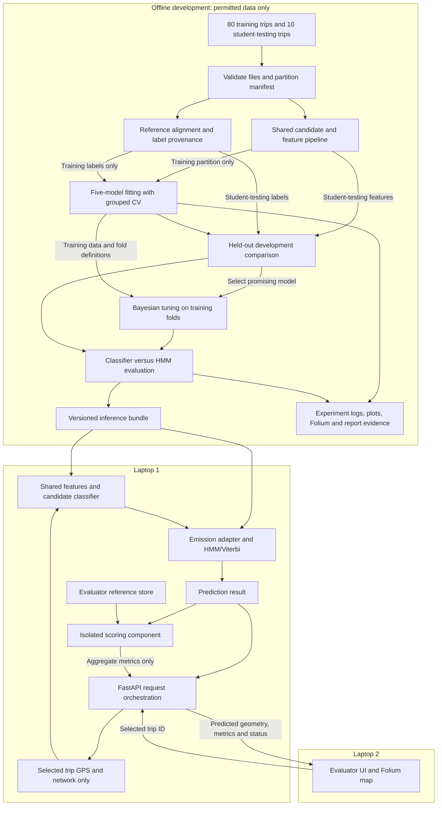

# PathSnap: proposed architecture after ten design reviews

Date: 18 November 2026 (Asia/Calcutta).

Status: architecture proposal, not an implemented or experimentally validated system. The dataset has not arrived. The ten iterations below are design reviews, not training runs. Each iteration retains the previous improvements and addresses a specific weakness. No accuracy, latency, dataset quality or model superiority is claimed.

Update, 18 November 2026: the user subsequently supplied Student folder.zip. See [iteration 11](ARCHITECTURE_ITERATION_11.md) for the current dataset-grounded revision using breadth-first and depth-first design review. Its segmentation, label-alignment gate, bounded routing and coverage changes extend this original proposal. Statements below about data being unavailable describe the initial design stage.

## 1. Scope and governing requirements

The system reconstructs a vehicle's road route from noisy GPS observations and the supplied road network. The proposed inference flow is:

`GPS + road network -> candidate segments -> shared feature pipeline -> learned candidate scores -> HMM/Viterbi -> predicted segments and route geometry`

The five supplied PDFs govern the design:

| Reference | Source | Relevant requirements |
|---|---|---|
| G1 | Main Guidelines.pdf, pp. 1-2 | Map matching; full ML workflow; two-laptop architecture; FastAPI |
| G2 | Dataset Exploration.pdf, pp. 1-4 | File schemas; EDA; 80/10/10 trip partitions; coordinate handling; reference limitations; leakage prevention |
| G3 | Models and Training Guidelines.pdf, pp. 1-6 | At least five models; Bayesian search; group-aware CV; metrics; HMM/Viterbi; all ten evaluator trips; API logs |
| G4 | Deliverables.pdf, pp. 1-7 | Public repository; consolidated PDF; per-model analysis; experimental plots; Folium; UI/API screenshots |
| G5 | Assessment and Plagiarism Policy.pdf, pp. 1-3 | Independent work; real experimental evidence; reproducibility; technical understanding; evaluator isolation |

Algorithm choices, module names, API routes and proposed metric definitions below are design decisions, not additional organiser requirements. External training data is not included in this proposal.

## 2. The ten iterations

### Iteration 1: establish the complete system boundary

**Initial design:** a classifier predicts roads from GPS, and a map displays its output.

**Review finding:** this omits sequence reconstruction, experimentation, server-side evaluation and the required distributed demonstration.

**Revision:** establish three connected workflows: offline experimentation, inference on Laptop 1, and an evaluator UI on Laptop 2. FastAPI owns the inference request. HMM/Viterbi follows the classifier. Scoring happens after prediction. Repository and report evidence are outputs of development.

**Why this is better:** the architecture now covers the complete task instead of just a prediction component.

**Review criterion:** every compulsory stage has an owner and a defined input/output. References: G1, G3, G4.

### Iteration 2: make data partitions and labels explicit

**Review finding:** a generic trip loader could accidentally load reference routes into prediction features or admit evaluator data into training.

**Revision:** use a partition manifest and separate interfaces for observation/network inputs and reference routes. Development commands accept training and student-testing partitions only. Evaluator data is introduced only for the final evaluation workflow. The prediction interface cannot accept a reference route. A separate scoring component can access evaluator references and returns aggregate results only.

**Why this is better:** leakage prevention becomes a data-flow property that can be tested, rather than a comment in a notebook.

**Tradeoff:** distinct loaders and explicit schemas add a small amount of code, but no additional network service is necessary.

**Review criterion:** training rejects evaluator trip IDs; prediction outputs do not change when references are unavailable; evaluator references never occur in UI responses, logs or exported maps. References: G2, G3, G5.

### Iteration 3: resolve what the model is learning

**Review finding:** a global classifier over raw arc IDs could learn arbitrary identifiers. The PDFs define an arc ID as a row index and do not establish globally shared IDs. Also, a chronological reference route is not necessarily a pointwise label array.

**Revision:** propose a shared binary candidate classifier. Each example describes one `(GPS observation, candidate road segment)` pair, with target match/non-match where defensible reference alignment exists. Features describe geometry and movement, not trip IDs or raw arc IDs. Preserve `(trip_id, arc_id)` as metadata. Introduce a separate development label builder that uses permitted reference routes, preserves route order/repeated traversals, and records alignment provenance and ambiguity.

**Why this is better:** the classifier can score candidates in another trip's network without requiring a fixed vocabulary of road IDs.

**Critical limitation:** the label-builder algorithm is not settled. Inspect actual files and any organiser alignment/scoring tools first. Do not label every road appearing anywhere in a route as positive for every observation. Do not equate nearest reference geometry with verified pointwise truth. If pointwise labels are derived, call the resulting measurements reference-alignment-based metrics and report unresolved-label coverage separately.

**Review criterion:** every usable training label has a documented source; ambiguous cases are counted; candidate generation does not consult labels. References: G2, G3.

### Iteration 4: strengthen geometry and candidate generation

**Review finding:** even an excellent classifier cannot select the correct road if candidate generation excluded it. Degree-based distances and reversed coordinate order can also invalidate features.

**Revision:** validate longitude/latitude order and use a justified metric projection or geodesic calculation. Build a spatial index over supplied road segments. Retrieve nearby segments, project each observation onto candidate geometry, and retain stable candidate-to-arc correspondence. Use a development-configured search radius and candidate cap, with bounded expansion if a candidate set is empty. Record candidate count, misses, expansions and unresolved observations.

**Why this is better:** candidate coverage becomes measurable independently of the classifier, and geographical calculations have explicit units.

**Tradeoff:** broader candidate sets improve coverage opportunities but increase classification and decoding cost. Choose limits using development data, not evaluator trips. Do not inject the reference road into candidate sets during evaluation to make coverage appear perfect.

**Review criterion:** report candidate miss rate on observations with usable reference labels, label coverage, runtime and memory. Preserve original observation IDs after filtering or sorting. References: G2, G3.

### Iteration 5: make model comparisons fair and reproducible

**Review finding:** five models are not a meaningful comparison if each receives different splits, labels, candidates or reporting rules. Random row splitting would leak closely related observations and candidate rows across folds.

**Revision:** create one experiment runner with trip-grouped folds on the 80 training trips. Keep all observations and candidates from each trip in one fold. Fit imputers, scalers, feature selectors, sampling rules and any calibration only inside the corresponding training fold. Share candidate policy, label version, feature version and held-out folds across the model comparison.

**Proposed five-model starting set:** Logistic Regression, Gaussian Naive Bayes, Decision Tree, Random Forest and Histogram Gradient Boosting. These are candidates for comparison, not a chosen winner. All are approaches listed in G3. Record all additional models actually tried.

**Why this is better:** performance differences are easier to attribute to models, and the experiment runner produces report evidence automatically.

**Tradeoff:** using full candidate sets initially is simpler and keeps evaluation consistent. If negative sampling becomes necessary for training, retain full evaluation sets and document effects on class balance and probability quality.

**Review criterion:** each run retains fold membership, seed, parameters, input/configuration hashes, metrics, timing and prediction records. References: G3, G4, G5.

### Iteration 6: define score interpretation and Bayesian tuning

**Review finding:** a binary match probability for each candidate is not automatically a probability distribution across all candidates for an observation. A classification score is also not automatically a generative HMM emission likelihood. Optimising candidate-row accuracy alone can favour the many negatives.

**Revision:** retain raw candidate match scores and define an explicit score-to-emission adapter. Proposed starting form: clip each match score away from zero, normalise within the observation, and use its logarithm as a discriminative emission potential. Document that interpretation; do not claim a learned generative likelihood. If calibration or emission scaling is used, fit/tune it using permitted development data with fold isolation.

**Tuning proposal:** after the initial five-model comparison, perform a genuinely Bayesian search on a promising model using trip-grouped CV within the 80 training trips. Predeclare the search space, trial budget and objective. Proposed objective: mean per-trip observation Top-1 accuracy including candidate misses among label-resolved observations. Always also report the required CV Macro F1 and other metrics. Refit on training data and compare untuned versus tuned results on the ten student-testing trips.

**Why this is better:** tuning targets the road-choice task while retaining the report's required classification measurements. Saved trials show why the final configuration was selected.

**Review criterion:** persist every trial and its status, not only the winner; justify the objective; report candidate binary log loss separately from any within-observation choice loss. References: G3, G4.

### Iteration 7: make sequence decoding realistic and numerically stable

**Review finding:** connecting nearest road segments alone can create wrong-way movements, impossible jumps or underflow when many probabilities are multiplied. Adjacent GPS points may legitimately span several arcs.

**Revision:** represent an HMM state as a candidate arc plus the observation's projected position on it. Determine graph directionality from the actual dataset; do not assume two-way travel. Use graph path distances between projected positions, accounting for partial start/end arcs and same-arc movement. Compare feasible network movement with observed displacement and elapsed time. Use log-space Viterbi, explicit initial-state scores and backpointers.

**Proposed recurrence:** `V_t(j) = log_emission_t(j) + max_i[V_(t-1)(i) + log_transition_t(i,j)]`. Store the maximising predecessor. An impossible transition has negative-infinite score. Transition normalisation, initial-state policy and any probability floors must be documented in the decoder configuration.

**Failure policy:** apply bounded candidate expansion first. If no feasible path remains, mark a sequence break and restart at a later resolvable observation. Large gaps receive elapsed-time-aware handling; any gap threshold is selected on development data. Unmatched observations remain explicit. Never silently draw a straight line across disconnected road components.

**Why this is better:** the decoder produces auditable sequence decisions and honest partial results instead of fabricating continuity.

**Review criterion:** compare classifier-only and classifier-plus-HMM on the same observations. Check same-arc travel, repeated arcs, intermediate road segments, disconnections and GPS gaps. The requirement remains a predicted segment for each relevant observation; unresolved cases are visible shortcomings to reduce, not permission to ignore difficult points. Reference: G3.

### Iteration 8: make evaluation informative and comparable

**Review finding:** the report requests Macro F1, Top-1 accuracy, continuity and sequence performance without fully defining every denominator or sequence metric. Dropping candidate misses or abstentions would inflate results.

**Revision:** create a metric registry with task level, denominator, aggregation, coverage and limitations for every measurement. Keep candidate classification, observation matching and route-sequence evaluation separate. Save classifier-only and decoded predictions together so before/after comparisons use identical data.

**Why this is better:** the report can distinguish good candidate scoring from good route reconstruction and reveal cases where HMM makes things worse.

**Tradeoff:** an organiser scoring contract may override proposed definitions. Implement it behind an adapter and retain separate diagnostic metrics instead of silently changing their meaning.

**Review criterion:** show per-trip results and aggregates; list excluded invalid inputs and unresolved reference labels; count candidate misses and unmatched predictions as errors where labels exist; report coverage alongside accuracy. References: G2, G3, G4.

### Iteration 9: make the two-laptop demonstration dependable

**Review finding:** a model notebook and a separate UI can drift in feature processing. A browser map may depend on internet tiles, and a slow request can produce duplicate runs or stale displays.

**Revision:** export one versioned inference bundle containing preprocessing, feature schema, candidate policy, model, score adapter and decoder configuration. Laptop 1 loads it once at startup and checks compatibility. The UI on Laptop 2 selects an available trip and sends only its ID to FastAPI. Each request gets a request ID; the UI disables duplicate submission while waiting, labels errors clearly and never presents an old trip's output as a new result.

**Deployment proposal:** keep a single backend service and a lightweight UI, with shared Python modules for development and inference. Use the local network for the required two-machine demonstration. Preload/index road inputs when allowed, but execute actual prediction for each evaluation request. Cache geometry and graph-distance calculations only; do not substitute prewritten trip predictions.

**Map design:** show raw GPS, road network and predicted route as distinct Folium layers. Reference-route layers are available in development maps only. Include legend, layer controls, sensible bounds and visible breaks. Plan a no-basemap fallback with locally available map assets so road/GPS overlays remain usable if external tiles fail; verify it in deployment testing.

**Review criterion:** before final evaluation, rehearse with permitted student trips across two physical laptops, including timeout/unreachable-backend cases. During final evaluation, support all ten reserved trips and show backend request logs. References: G1, G3, G4.

### Iteration 10: audit completeness and keep the implementation manageable

**Review finding:** a design can satisfy the prediction requirements while leaving the report, artifacts, evidence and viva until the end. Extra services also add failure points without addressing a stated requirement.

**Revision:** retain a modular single backend, lightweight UI and offline experiment runner. Generate tables, plots and development Folium maps from saved runs. Add a reproducibility manifest and submission checklist. Keep an explicit register of dataset-dependent decisions and final-scoring uncertainties. Stage development so ingestion/EDA and a baseline can be shown early; the PDF mentions a before-lunch first phase but does not define its assessment scope.

**Why this is better:** implementation, demonstration and reporting use the same artifacts, while the system stays explainable by the team.

**Final review outcome:** the proposal addresses the documented requirements. Actual compliance still requires data inspection, real model experiments, an implemented decoder, two-laptop testing and complete submission evidence. No design review establishes empirical correctness.

**Review criterion:** every requirement below maps to a component and an observable artifact; every unsettled issue is marked as such. References: G1-G5.

## 3. Final architecture



The reference store has no path into candidate generation, prediction or the UI. During development, permitted references supply supervised labels and offline diagnostics. At final evaluation, reference access is confined to scoring after a prediction has been generated and fixed.

The shared development pipeline preserves partition metadata throughout. Its learned transformations are fit inside training folds, then applied to held-out data. The ten student-testing trips are for development comparison and permitted decoder tuning; they are not added to classifier fitting. Because these trips influence development choices, their results are development estimates, not an untouched final generalisation estimate.

## 4. Component responsibilities and data contracts

| Component | Input | Output and design constraint |
|---|---|---|
| Dataset registry | Organiser files and split manifest | Trip metadata, partition, file hashes; reject unknown/mispartitioned development inputs |
| Raw validator | `.track`, `.nodes`, `.arcs` | Parsed observations, validated network, anomalies; retain original row identity |
| Development label builder | Permitted `.route` plus observations/network | Reference alignment, provenance, ambiguity flags; no dependency from inference |
| Geometry and graph module | Validated road network | Spatial index, metric geometry, connectivity; retain `(trip_id, arc_id)` |
| Candidate generator | Observation, network, frozen policy | Candidate arc IDs and projections; no reference access |
| Feature builder | Candidates and observation sequence | Versioned feature rows; fitted transforms from training only |
| Candidate classifier | Feature rows | Match scores per candidate; raw IDs are metadata, not predictors |
| Emission adapter | Candidate scores | Documented log emission potentials with stable candidate ordering |
| HMM/Viterbi | Emissions, graph, time/displacement | Per-observation arc assignment, path connectors, breaks and unmatched flags |
| Scorer | Fixed predictions and isolated references | Defined aggregate metrics and coverage; never returns evaluator reference geometry |
| FastAPI | Registered trip ID | Typed response, request ID and operational logs |
| UI and Folium | Prediction response | Selected-trip route and results; no training logic or reference labels |
| Evidence exporter | Actual saved development runs | Reproducible comparison tables, figures, maps and report inputs |

Proposed inference entry point: `predict(observations, road_network, inference_bundle) -> PredictionResult`.

Proposed scoring entry point: `score(prediction_result, reference_data, scoring_contract) -> AggregateMetrics`.

The request orchestrator calls prediction first and scoring second. Prediction modules do not import reference-loading or scoring modules. Missing scorer references should produce an explicit scoring-unavailable status, not a fabricated accuracy value.

### Proposed features

- GPS-to-candidate projected distance in metres.
- Heading disagreement where movement supports a reliable heading estimate.
- Distance to candidate endpoints and position along the segment.
- Segment orientation and length.
- Observed displacement, elapsed time and derived speed, with validity flags.
- Local graph connectivity descriptors only where well-defined.

These are hypotheses to assess using training data. Feature windows may use the whole trip because the specification describes selected-trip reconstruction, not necessarily online streaming; document any use of future observations. Do not assume streaming latency requirements. Raw arc IDs, trip IDs, reference-route membership and evaluator scores are prohibited feature inputs in this proposal.

## 5. Evaluation contract proposed for development

| Measurement | Proposed definition and reporting rule |
|---|---|
| Candidate Macro F1 | Binary match/non-match Macro F1 on full candidate rows with usable labels; retain threshold/configuration and class balance |
| Candidate log loss | Binary loss on raw/calibrated candidate match probabilities; specify clipping and aggregation |
| Observation Top-1 | Correct selected arc / label-resolved observations; candidate misses and unmatched predictions count as incorrect |
| Candidate miss rate | Reference arc absent from candidate set / label-resolved observations, including empty candidate sets |
| Label coverage | Observations with a usable reference alignment / observations considered; report invalid-input exclusions separately |
| Prediction coverage | Observations with a predicted arc / valid input observations; do not use coverage to hide errors |
| Decoded pointwise accuracy | Same denominator and alignment contract as Top-1, after Viterbi |
| Route continuity | Proposed: feasible connected transitions / eligible consecutive observation pairs; count prediction breaks as failures and separately report pairs excluded for invalid inputs |
| Sequence quality | Proposed: arc-sequence edit distance, using documented consecutive-duplicate handling and preserved later revisits; compare complete reconstructed sequences including connectors |
| Runtime | Separate feature/candidate, scoring and decoding stages; also report end-to-end inference and training time |

Report pooled metrics and mean per-trip metrics distinctly. For each comparison use the same trip set, candidate policy, label version and denominator. For sequence edit distance, retain raw counts and state the normalisation if used. These metric definitions need confirmation against any organiser scoring contract; candidate binary Macro F1 must not be mislabeled as road-ID multiclass Macro F1.

If a correct arc is missing from the candidate set, candidate-row metrics alone cannot capture the whole failure. Always show observation metrics and candidate miss rate alongside them. If a reference alignment is uncertain, do not treat it as independently verified ground truth.

## 6. Proposed API and UI behaviour

Endpoints are proposals; the guidelines require FastAPI but do not prescribe route names.

- `GET /health`: ready/not-ready state and loaded model version; no local filesystem paths or reference details.
- `GET /trips`: permitted selectable trip IDs and safe descriptive metadata. During final evaluation the list contains the ten reserved trips.
- `POST /predict`: body contains a registered `trip_id`; arbitrary uploaded paths and reference labels are not accepted.

The response includes `request_id`, `trip_id`, `model_version`, status, per-observation predicted arc IDs or explicit unmatched flags, GPS points, permitted road geometry, predicted route geometry, sequence-break information, aggregate evaluation metrics with their definitions/coverage, and timing. Use JSON-safe representations for unavailable values. Return separate classifier-only results if the UI needs that comparison, without changing the final chosen pipeline.

Operational logs record request ID, trip ID, bundle version, duration and status. They must demonstrate real endpoint activity without printing evaluator references. Validation errors, unknown trip IDs, unloaded models and scoring-unavailable conditions have distinct messages. UI state distinguishes waiting, success, partial result and failure. An accuracy value is never displayed until a genuine scoring result exists.

Start with a single synchronous prediction request. Measure runtime on development trips; add a background job/polling contract only if observed duration warrants the complexity. Do not promise a latency target before measurements.

## 7. Repository and evidence structure

```text
pathsnap/
  README.md
  requirements.txt
  configs/                 # candidate, feature, model, decoder and run settings
  manifests/               # split metadata and fingerprints, no evaluator labels
  src/
    data/                  # prediction-input loading and validation
    geometry/              # spatial index, projection and road graph
    candidates/
    features/
    models/
    decoding/
    evaluation/            # separate references, alignment and scoring
    api/
    visualization/         # shared Folium generation
  ui/
  experiments/             # model comparison and Bayesian search entry points
  artifacts/               # final bundle, subject to repository size limits
  results/                 # actual development metrics, configs and trial history
  reports/                 # generated figures, maps, screenshots and final PDF
  tests/                   # targeted correctness and leakage checks
```

Keep raw evaluator references outside public submission paths and outside the inference bundle. Raw dataset redistribution is not assumed authorised; follow organiser instructions. Include saved weights/configurations subject to repository size limits and explain any artifact delivery arrangement. The public repository must still make the reported experiments verifiable.

Automate report inputs from real runs: dataset inventory, EDA figures, five-model comparison, per-model configurations and results, Bayesian trials, tuned/untuned comparison, classifier/HMM comparison, timing and failure examples. Document every model actually tried. Epoch loss curves are included only for models that actually produce such histories. Development Folium maps may show references; evaluator UI maps may not.

The final report should use A4 with no added headers or footers unless requested otherwise. Record AI assistance as required by event policy; the exact disclosure format is not supplied. Every team member should be able to explain labels, features, comparisons, tuning, decoder, API and results.

## 8. Verification plan and implementation order

These are future checks, not checks already executed.

1. **Data gate:** inspect supplied files and official partitions; verify IDs, coordinates, timestamps, graph directionality, repeated reference arcs and route alignment. Produce inventory and EDA.
2. **Baseline gate:** deterministic candidates, documented labels and shared features; obtain an initial model result and development Folium map. A simple geometric baseline may be diagnostic but does not replace any of the five trained models.
3. **Experiment gate:** five models on matching grouped folds; complete logs and held-out development comparisons; genuine Bayesian optimisation; final bundle selected from evidence.
4. **Decoder gate:** test known small graphs for impossible transitions, same-arc movement, partial arcs, directionality and gaps; verify Viterbi against exhaustive enumeration on tiny cases; compare with classifier-only outputs.
5. **Integration gate:** saved-bundle prediction matches offline inference; prediction succeeds without reference access; references never enter API responses; unchanged predictions when scoring data changes; schemas preserve observation/candidate identity.
6. **Deployment gate:** two-laptop rehearsal on student-testing trips; real request logs; route geometry and metrics agree; offline-map fallback and failure states checked. Do not use evaluator trips as a development rehearsal.
7. **Submission gate:** repository accessible and reproducible; weights/configurations present as allowed; consolidated report contains the required tables, actual graphs, Folium screenshot, interactive map/code and UI/API evidence.

## 9. Requirements traceability

| Requirement | Architectural owner | Evidence needed |
|---|---|---|
| Understand and inspect raw data | Validator, inventory and EDA | File counts, anomalies, spatial plots and assumptions |
| At least five trained models | Experiment runner | Per-model configurations and actual results |
| Group-aware training evaluation | Split registry and runner | Fold manifest with no trip overlap |
| Bayesian optimisation | Search runner | Search space, objective, trial history and tuned comparison |
| HMM/Viterbi reconstruction | Decoder | Explanation, correctness checks and classifier/HMM comparison |
| Pointwise and sequence evaluation | Metric registry and scorer | Defined denominators, continuity and sequence results |
| Two-laptop deployment | FastAPI and evaluator UI | Live demonstration and receiving-laptop logs |
| All ten reserved trips | Registered final-evaluation trip loader | Operational support at evaluation; no development tuning on them |
| Evaluator ground-truth isolation | Separate reference loader/scorer | Dependency and response inspection; leakage tests |
| Folium visualisation | Shared map generator | Actual development map screenshot and HTML/generation code |
| Public repository | Submission packaging | Complete source, README, dependencies, allowed artifacts and logs |
| Consolidated report | Evidence exporter and team analysis | All required sections and defensible results |
| Original, reproducible work | Run records and team review | Genuine experiments and explainable choices |

## 10. Decisions deliberately deferred

- Dataset location, exact filenames, official split membership and checksums.
- Whether networks share IDs; whether arc direction is authoritative; whether geometry is limited to node-to-node segments.
- Availability of official observation labels, alignment code and final scoring rules.
- How to handle ambiguous route alignment without overstating pointwise accuracy.
- Metric coordinate system, candidate radius/cap, search expansion and GPS-gap thresholds.
- Winning model, final feature set, any calibration, Bayesian trial budget and decoder settings.
- Dataset size, laptop resources, practical runtime and whether asynchronous requests are needed.
- Exact first-phase schedule, grading weights, AI disclosure format and raw-data redistribution terms.

The settled proposal is the component structure, data boundaries and experimental process. Dataset-sensitive parameter choices and the final model remain evidence-driven decisions.
