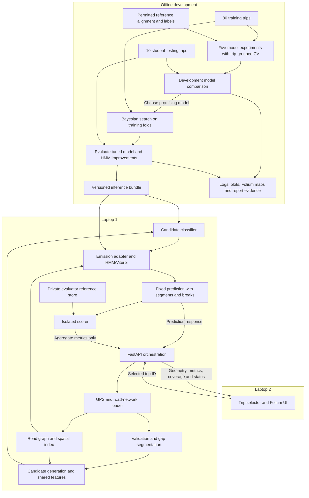

# PathSnap: architecture and complete workflow

Consolidated design, 18 November 2026. Incorporates the initial ten architecture reviews and the dataset-grounded eleventh review.

**Status:** this is the proposed implementation architecture. Structural dataset inspection is complete for the checks reported here; model training, alignment validation, implementation and deployment testing are not complete. All model choices, thresholds and scoring definitions identified as proposals still require evidence or organiser confirmation.

## 1. What the system does

PathSnap takes noisy GPS observations from a vehicle and matches them to a supplied road network to reconstruct its likely route. GPS points can fall between roads, on parallel streets or far from the actual path. Selecting the nearest road independently for every point can therefore produce an implausible journey.

The solution combines two decisions:

1. **Candidate classification:** which nearby road segments fit this GPS observation?
2. **Sequence decoding:** which sequence of candidate segments best explains the movement over time and respects the road network?

A trained classifier performs the first task. HMM/Viterbi combines its scores with movement and road connectivity for the second. FastAPI serves the pipeline on Laptop 1; an evaluator-facing UI with Folium maps runs on Laptop 2.

## 2. Data and confirmed findings

The supplied archive is `C:\Users\Abhinav Krishna\Downloads\Student folder.zip`.

| Partition | Trips | GPS observations | Role |
|---|---:|---:|---|
| train | 80 | 208,417 | Classifier fitting, grouped cross-validation and Bayesian optimisation |
| student_test | 10 | 19,160 | Development comparison, tuned-model evaluation and permitted decoder tuning |
| Evaluator testing | 10 specified by guidelines; absent from supplied ZIP | Not inspected | Final evaluation only |

Each supplied trip has four headerless, whitespace-separated files:

| File | Contents | Identity convention |
|---|---|---|
| `.track` | Longitude, latitude, timestamp in seconds | Preserve original observation row ID |
| `.nodes` | Longitude and latitude | Zero-based row index is node ID |
| `.arcs` | From-node ID and to-node ID | Zero-based row index is arc ID |
| `.route` | Chronological reference arc IDs | Route occurrence order matters, including later revisits |

The structural audit verified the documented column counts, valid arc-to-node and route-to-arc references, and strictly increasing timestamps in all 90 supplied trips. It also found:

- No trip has equal `.track` and `.route` row counts. A reference-route row is not a direct GPS-row label.
- The largest adjacent timestamp gap is 153,064 seconds, about 42.5 hours, in training trip `00000090`.
- Fourteen consecutive reference-arc pairs, across eleven trips, do not directly join at their endpoints. This does not establish that they are unreachable; omitted intermediate arcs or reference conventions may explain them.
- The largest road network has 155,003 nodes and 307,392 arcs, in trip `00000013`.
- All 90 network byte hashes differ. This does not prove geographic independence between trips.
- Reverse endpoint pairs are not present for every arc in every trip. Preserve supplied directions initially; legal travel semantics still need investigation.

These findings motivate explicit alignment, segmentation, scalable routing and cautious evaluation. They are structural observations, not evidence of model performance.

## 3. Overall architecture



The bundle also configures segmentation, candidates, features and fitted preprocessing, although those arrows are omitted for readability. The same pipeline code runs in experiments and deployment. The offline diagram separates training from development comparison: the student-testing trips are not added to classifier fitting.

**Prediction never receives a reference route.** During training, permitted references provide supervision through a separate alignment component. During final evaluation, private references are used only after prediction, inside the scorer. The UI receives aggregate scores, never evaluator reference labels or reference geometry.

## 4. Component responsibilities

| Component | Responsibility | Output |
|---|---|---|
| Dataset registry | Preserve official split, trip IDs and source fingerprints | Partition-aware file manifest |
| Validator | Check schemas, coordinates, IDs, timestamps and invalid observations | Validated inputs and explicit anomaly records |
| Segmenter | Identify qualifying GPS gaps; preserve original trip and observation identities | Segment IDs, boundaries and feature-validity flags |
| Reference alignment | Associate permitted reference-route occurrences with observations | Derived labels, provenance and ambiguity flags |
| Geometry and graph | Metric coordinates, sparse directed adjacency and spatial indexing | Candidate search and weighted path-query services |
| Candidate generator | Retrieve nearby road segments without reference access | Candidate IDs and projected positions |
| Feature builder | Compute consistent candidate/observation features | Versioned feature rows |
| Classifier | Estimate candidate match scores | Scores for each candidate |
| Emission adapter | Convert classifier scores to documented decoder potentials | Log emission scores |
| HMM/Viterbi | Combine scores with feasible movement and network paths | Predicted arc per relevant observation and route connectors |
| Scorer | Compare fixed predictions against isolated references | Metrics, denominators and coverage |
| FastAPI | Load bundle, validate requests and orchestrate inference/scoring | Typed response and operational logs |
| UI/Folium | Select trip and visualise the returned result | Maps, scores and clear partial/error states |
| Experiment/evidence runner | Run reproducible comparisons and export actual results | Trial logs, tables, plots and report inputs |

These are modules, not separate microservices. The initial deployment needs one backend service and one lightweight UI.

## 5. Complete development and training workflow

### Step 1: preserve and inventory the dataset

Keep the source archive unchanged. Register the existing 80/10 split instead of generating a new train/student-test partition. Fingerprint source files and record row counts, schemas, coordinate ranges, sampling intervals and anomalies. Inspect road-network geometry and reference-route conventions. Create EDA plots and permitted development Folium maps.

Never infer the held-out evaluator routes from absent trip IDs or use evaluator data for development.

### Step 2: validate and segment observations

Validate coordinate order and numerical values. Select an appropriate metric projection or geodesic computation after checking the geographical extent. Ordinary Euclidean distances in latitude/longitude degrees are not suitable physical-distance features.

Choose and justify a gap policy using training data. At a qualifying boundary, reset temporal feature windows and Viterbi initialisation. Preserve the original observation IDs and original trip grouping. A segmented trip must remain wholly within one cross-validation fold.

Do not draw or claim an observed journey across a long missing interval. The segmentation threshold is not yet selected; the 42.5-hour gap demonstrates the need for a policy, not its exact value.

### Step 3: establish usable supervision

First seek any organiser-provided pointwise labels, reference alignment tools or scoring rules. Otherwise, develop a documented order-aware alignment between GPS observations and occurrences in the reference arc sequence.

A proposed approach permits several GPS observations on one route occurrence and skipped route occurrences when sampling is sparse, while preserving chronology and later revisits. Treat large gaps and unexplained reference discontinuities explicitly. Assign ambiguity/unresolved flags instead of forcing labels.

Do not equate row numbers across files, mark every route arc positive for every observation, or present nearest-reference-road assignments as independently verified physical truth. Inspect representative alignments on maps and retain provenance. The final label-building algorithm remains unresolved.

**This step is a prerequisite for trustworthy supervised model comparisons.** Geometry-derived labels can favour geometry-based features, so report that limitation and test sensitivity to reasonable alignment choices. Do not optimise labels to make classifier accuracy look better.

### Step 4: construct road geometry and candidates

Use `(trip_id, arc_id)` to identify a road segment. Preserve from/to direction initially, while investigating its meaning. Build sparse graph adjacency and a spatial index. Query nearby segments for each observation, project the observation onto candidate geometry and retain projection positions and distances.

Use a configurable search radius, candidate cap and bounded expansion policy. These values must come from development evidence. A reference road must never be injected into candidates to improve measured coverage. Count observations with empty candidates or missing reference candidates.

Large networks are loaded as needed. Use bounded on-demand weighted graph routing and memory-limited caches, rather than precomputing every node-pair distance. Cache node-to-node path results with network identity, then account separately for projected endpoint offsets. Cache invalidation must reflect changes to the relevant data and configuration.

### Step 5: produce candidate features

Each training row represents an observation/candidate pair. Its target is match/non-match where a defensible aligned reference exists. Candidate metadata keeps observation, segment, trip and arc identities; those identifiers are not model features.

Proposed features include GPS-to-segment distance, heading disagreement, projection position along the segment, endpoint distances, segment orientation/length, elapsed time, displacement, speed and suitable connectivity descriptors. Include validity flags when motion is too small or a gap makes direction/speed unreliable.

Feature choices are hypotheses to evaluate. The task is selected-trip reconstruction, so using future observations is possible if explicitly documented; streaming behaviour is not assumed. No reference membership or evaluator information enters feature computation.

### Step 6: train and compare at least five models

Proposed starting models:

| Model | Purpose in the comparison |
|---|---|
| Logistic Regression | Linear probabilistic baseline |
| Gaussian Naive Bayes | Simple probabilistic baseline with different assumptions |
| Decision Tree | Interpretable nonlinear decision rules |
| Random Forest | Ensemble of trees |
| Histogram Gradient Boosting | Boosted nonlinear model |

Use common trip-grouped folds within the 80 training trips. Keep candidates and segments from a trip together. Fit scalers, imputers, feature selectors, calibration and any training sampling inside each training fold, never across held-out folds.

Compare models using the same candidate policy, label version, feature definition and held-out data. Record seeds, configurations, metrics, per-trip predictions, training time and inference time. Document every additional model tried. A geometric baseline is useful diagnostically but does not replace the required trained models.

Evaluate fitted models on the ten student-testing trips for development comparison. Because these results influence development, do not describe them as an untouched final test estimate.

### Step 7: perform Bayesian hyperparameter optimisation

Choose a promising model from real comparisons. Specify the search space, Bayesian search method, trial budget and objective before running the search. Use trip-grouped cross-validation within the 80 training trips.

The proposed objective is mean per-trip observation Top-1 accuracy on label-resolved observations, counting candidate misses as incorrect. Always also report required CV Macro F1 and the other applicable metrics. The objective remains subject to label/scoring validation.

Retain every trial, including failed trials and their status. Refit the chosen configuration on training data and compare tuned versus untuned performance on the student-testing trips. No winning model or trial budget is claimed in this design.

### Step 8: connect classifier scores to HMM/Viterbi

A binary candidate match score is not automatically a distribution across candidates or a generative emission likelihood. Use an explicit adapter. The proposed starting adapter clips scores away from zero, normalises them within an observation and takes logarithms, treating them as discriminative emission potentials. Document calibration and any scaling; fit learned calibration with proper fold isolation.

The hidden state is a candidate arc with its projected position. Transition scores consider directed graph feasibility, network movement, observed displacement and elapsed time. Handle same-arc motion, partial starting/ending arcs and paths through intermediate arcs.

For a state j at observation t, the log-space recurrence is:

```text
V[t, j] = log_emission[t, j]
          + max_i(V[t-1, i] + log_transition[t, i, j])
```

Keep a backpointer to the best predecessor and backtrack to recover the sequence. Specify initial scores, transition normalisation and numerical floors. Impossible transitions receive negative-infinite scores.

If bounded candidate expansion cannot restore a feasible sequence, retain an explicit break and restart at a resolvable observation. Missing predictions are shortcomings to report and reduce, not a way to exclude difficult observations. Never fabricate a connector across a gap or disconnected route.

### Step 9: compare classifier-only and decoded results

Save both predictions for the same observations and candidate sets. Measure whether HMM improves pointwise matching and route quality, including cases where it makes results worse. Tune decoder settings using permitted development data only.

Generate Folium development maps showing raw GPS, road network, reference route where permitted, classifier-only predictions and decoded routes. Use distinguishable layers, a legend and visible breaks. All maps and performance plots must come from actual outputs.

### Step 10: export a reproducible inference bundle

Package the selected classifier, fitted preprocessing, feature schema, segmentation policy, candidate settings, score adapter, decoder configuration and version metadata. Include the corresponding source/configuration fingerprints and dependencies.

The backend checks bundle compatibility at startup. Offline and served predictions must agree for identical inputs and configuration. Do not package evaluator references inside the inference bundle.

## 6. Complete live prediction workflow

1. Start FastAPI on Laptop 1 and load the validated inference bundle.
2. Start the UI on Laptop 2 and configure its backend address over the local network.
3. The UI retrieves selectable trip IDs. At final evaluation these are the ten reserved trips.
4. The evaluator selects a trip; the UI sends its ID to the API.
5. The API creates a request ID and loads that trip's GPS and road network through prediction-only loaders.
6. The shared pipeline validates inputs, segments gaps, generates candidates, builds features, scores candidates and decodes each sequence.
7. It fixes the prediction result, including per-observation assignments, route geometry, unmatched points and break reasons.
8. The separate scorer loads private reference information and applies the official scoring contract. It cannot modify predictions.
9. FastAPI returns predicted geometry, allowed GPS/network layers, scores, coverage, timing and status. It does not return evaluator reference labels or geometry.
10. The UI renders the Folium map and results. Separate decoded pieces stay separate on the map. Backend logs show the actual receiving-laptop request and completion.

Start with synchronous requests. Measure development runtime before adding background jobs or polling. Disable duplicate submission while waiting and avoid showing a previous trip's results as a new response.

## 7. API and result contracts

These endpoint names are proposals; FastAPI itself is required by the guidelines.

| Endpoint | Purpose |
|---|---|
| `GET /health` | Backend readiness and loaded model version |
| `GET /trips` | Registered selectable trip IDs and safe metadata |
| `POST /predict` | Accept a registered trip ID and run actual prediction/scoring |

Conceptual internal interfaces:

```text
predict(observations, road_network, inference_bundle) -> PredictionResult
score(fixed_prediction, private_reference, scoring_contract) -> AggregateMetrics
```

PredictionResult contains request/trip/model identifiers, status, original observation IDs, predicted arc IDs or unmatched flags, segment IDs, break reasons, predicted geometry and timings. The API attaches aggregate metrics and their coverage/definition metadata when available.

Reject unknown trip IDs and incompatible bundles explicitly. An absent reference produces scoring-unavailable, not invented accuracy. Operational logs record request ID, trip ID, model version, duration and status without reference contents.

## 8. Metrics and honest reporting

| Metric | Proposed interpretation |
|---|---|
| Candidate Macro F1 | Binary match/non-match Macro F1 on candidate rows with usable labels; retain threshold and class-balance details |
| Candidate log loss | Binary loss on candidate match probabilities; distinguish from normalised candidate-choice loss |
| Observation Top-1 | Correct highest-scoring arc divided by label-resolved observations; misses/unmatched predictions count as wrong |
| Candidate miss rate | Reference arc absent from candidates divided by label-resolved observations, including empty candidate sets |
| Decoded pointwise accuracy | Same reference alignment and denominator as Top-1, after Viterbi |
| Label coverage | Fraction of considered observations with usable reference alignment |
| Prediction coverage | Fraction of valid input observations with a predicted road segment |
| Route continuity | Feasible connected transitions across eligible valid consecutive observations; report breaks, exclusions and a separate within-segment diagnostic |
| Sequence performance | Proposed arc-sequence edit-distance diagnostic with documented duplicate handling, connectors and normalisation |
| Runtime | Training, feature/candidate generation, classification, decoding and end-to-end inference time |

Report applicable precision, recall and confusion matrices as well. Distinguish pooled metrics from per-trip averages. List invalid-input exclusions and unresolved reference labels. Do not call candidate binary Macro F1 a road-ID multiclass metric. An official scoring contract takes precedence; retain separately named diagnostics if it differs.

Geometrically derived labels are not independently verified physical truth. Different graph files also do not prove geographically independent validation. State those limits and investigate spatial overlap before making geographical generalisation claims.

## 9. Reliability and scale

- Preserve the supplied graph until direction and reference conventions are understood; investigate the 14 non-adjacent reference pairs without silent repairs.
- Use spatial indexing and sparse adjacency, with lazy loading and bounded caches. Avoid all-pairs routing tables for large networks.
- Cache deterministic geometry/raw features where appropriate, but keep fitted transforms fold-local. Include network and configuration identity in cache keys.
- Keep geometry caching distinct from hardcoded predictions; each evaluation request must run real inference.
- Show partial results and missing predictions honestly. Keep map layers, counters and response status consistent.
- Provide a no-basemap display fallback with locally available map assets, and test that road/GPS overlays remain usable if external tiles fail.
- Check request failure, timeout, backend unavailability and stale UI states on development trips.

## 10. Repository, report and demonstration evidence

```text
pathsnap/
  README.md
  requirements.txt
  configs/          # pipeline, model and decoder settings
  manifests/        # split metadata and data/configuration fingerprints
  src/
    data/
    segmentation/
    geometry/
    candidates/
    features/
    models/
    decoding/
    evaluation/     # isolated alignment/reference/scoring code
    api/
    visualization/
  ui/
  experiments/      # comparison and Bayesian search
  artifacts/        # allowed saved model and inference configuration
  results/          # real runs, trial history, predictions and metrics
  reports/          # actual plots, maps, screenshots and consolidated PDF
  tests/
```

The final submission consists of a public GitHub repository and one consolidated PDF report. Include complete source for preprocessing, features, every trained model, evaluation, Bayesian search, HMM/Viterbi, API, UI and maps. Include model weights/configurations subject to repository constraints and explain execution/deployment clearly.

The report must include dataset understanding/EDA, every model tried and its actual behaviour, consolidated comparisons, Bayesian settings/trials and tuned comparisons, classifier-versus-HMM analysis, Folium visualisations and deployment evidence. Include a representative map screenshot/export in the PDF and interactive HTML or generation code in the repository. Include UI screenshots and receiving-laptop API evidence. Do not fabricate loss curves for models that do not produce epoch histories.

Use A4 with no added page headers or footers by default. Keep evaluator references outside public artifact paths; raw-data redistribution requires organiser guidance. Record AI assistance as required by the event, and ensure the team can explain all submitted work. The specified before-lunch first phase needs schedule/scope confirmation.

## 11. Implementation and verification sequence

| Stage | Completion evidence |
|---|---|
| Data understanding | Inventory, EDA, anomaly investigation and documented network conventions |
| Label validity | Alignment examples, ambiguity accounting and compatible scoring definitions |
| Baseline pipeline | Reproducible candidates/features and development map |
| Model experiments | Five actual model comparisons, grouped folds and complete logs |
| Bayesian tuning | Genuine saved search trials and tuned/untuned comparison |
| Decoder correctness | Tiny-graph Viterbi checked against exhaustive sequence enumeration; tests for direction, same-arc travel, partial arcs and gaps |
| Integration | Offline/served prediction agreement, cache-on/off agreement, reference isolation and response-schema checks |
| Deployment | Two-physical-laptop rehearsal on permitted student-testing trips, live logs and failure-state checks |
| Submission | Accessible source/artifacts, reproducible evidence and complete consolidated report |

These are planned checks, not completed tests. Final evaluator trips are reserved for final evaluation and must not be used to tune the system during rehearsal.

### 11.1 Validation status and decision rules

**Already checked:** archive partition counts, file presence, documented column widths, node/arc index bounds, timestamp ordering, row counts, network byte hashes and the structural anomalies listed in section 2. The saved audit script reproduces all 90 per-trip records.

**Not yet established:** physical coordinate correctness, route-label alignment, road direction semantics, suitable gap/candidate settings, accuracy, probability quality, decoder correctness, inference speed, leakage resistance of an implementation, or two-laptop operation. A plausible architecture does not validate any of these.

Separate three kinds of validation:

- **Correctness checks:** exact invariants such as no shared trip IDs between folds, no evaluator references in responses and Viterbi agreement with exhaustive search. These must pass, rather than merely improve a metric.
- **Empirical choices:** compare candidate coverage, model quality, route quality and computational cost on permitted development data. Set decision criteria before comparing results; no organiser accuracy or latency threshold is supplied.
- **Organiser contracts:** confirm the authoritative label/scoring convention and event requirements. Local tests cannot establish what an unspecified official metric means. Record any unanswered question and label provisional results accordingly.

### 11.2 Before trustworthy supervised training

| ID / what to validate | How to validate | Completion criterion and evidence | Blocks |
|---|---|---|---|
| V1: partition and input identity | Verify 80/10 registry membership, one complete file set per trip, no duplicate trip IDs across partitions; hash source files. Check exact duplicate inputs and separately assess geographic overlap. Keep source inputs immutable. | Saved manifest; zero trip-ID overlap. Investigate duplicates, but do not reassign the official split without organiser guidance. Spatial overlap is reported, not automatically an invalid split. | Reliable experiment tracking and generalisation claims |
| V2: coordinate interpretation | Check finite values, plausible longitude/latitude ranges and map overlays for representative trips. Compare chosen projected distances against an independent geodesic computation across the observed extent. Check point-to-segment projections with small hand-calculable geometries. | Document coordinate order, units, projection and a justified distance-error tolerance before relying on distance features. Save discrepancy statistics and representative maps. | Geometry, candidates and distance-based features |
| V3: road and reference conventions | Inspect all 14 non-adjacent reference pairs: IDs, coordinates, repeated arcs, reverse pairs and possible intervening paths. Inspect representative normal route sections too. Compare directed connectivity with the observed route convention; request organiser clarification if evidence remains ambiguous. | Every anomaly has a documented explanation or an unresolved flag and handling policy. No silent added/reversed edges. Save a case table and map excerpts. | Final graph semantics, reference alignment and transition rules |
| V4: reference-to-GPS alignment | Obtain official labels/alignment/scoring code if available. Otherwise inspect a reproducible sample of training examples covering simple roads, junctions, parallel roads, revisits, sparse points and gaps. Review a proposed order-aware alignment against the raw GPS and ordered route, with classifier predictions hidden. Use a second reviewer where possible; mark genuine ambiguity. | Versioned alignment policy; sample-selection record; reviewed cases; ambiguity/coverage counts; disagreements and sensitivity to alternative reasonable policies. Manual interpretation of the same reference data is not independent physical ground truth. Without official pointwise labels, results stay explicitly derived-label measurements. | Meaningful supervised labels, model ranking and pointwise accuracy claims |
| V5: gaps and segmentation | Compute training sampling-interval distributions and inspect observations before/after unusual gaps, particularly trips 00000078 and 00000090. Verify seconds interpretation, displacement and possible recording-session boundaries. Compare candidate gap policies on training development folds without changing source timestamps. | Freeze a justified gap rule; preserve all observation IDs; verify no temporal feature spans a declared break and Viterbi restarts there. Save gap inventory, sensitivity results and maps. No threshold is chosen merely from the maximum gap. | Trustworthy motion features and sequence reconstruction |

Unresolved V4 does not prevent building loaders, geometry, API schemas or a diagnostic unsupervised baseline. It prevents claiming a valid supervised comparison. Unresolved official scoring does not require guessing: keep a replaceable scorer interface and clearly named provisional diagnostics.

### 11.3 Before choosing and tuning a model

| ID / what to validate | How to validate | Completion criterion and evidence | Blocks |
|---|---|---|---|
| V6: candidate coverage and cost | On label-resolved training validation observations, sweep plausible radius/cap/expansion settings. Measure misses including empty sets, candidates per observation, time and memory. Inspect misses on maps. Compare the spatial index against brute-force distance search on a small deterministic sample. | Indexed retrieval agrees with its specified search semantics. Select a documented coverage/cost tradeoff; retain full evaluation candidates and never inject reference arcs. Log unresolved-label coverage separately. No universal miss-rate target is assumed. | Final candidate settings and fair comparisons |
| V7: feature and split leakage | Assert that every original trip and all its segments/candidates remain in one fold. Trace fitted-transform training indices. Deliberately change held-out values and verify fitted training statistics do not change. Review feature columns for reference data, IDs and target-derived fields. | Zero trip overlap; train-only fit provenance; no reference-derived predictor. Retain fold manifests and automated invariant results. Deterministic feature caching must not become full-data scaler fitting. | Any defensible CV estimate |
| V8: model comparison | Train the five specified candidate models on the same folds and policies. Collect per-trip and aggregate metrics, timing, configuration and failures. Inspect false matches, candidate misses and behaviour by trip. Check seed sensitivity where relevant. | All five have actual reproducible results. Choose using a predeclared task-relevant objective, stability and computational constraints; justify tradeoffs. Do not choose using training accuracy alone. | Selecting the model to optimise |
| V9: score quality | Evaluate binary log loss and reliability/calibration diagnostics on held-out training folds. Verify the emission adapter preserves candidate ordering/identity and handles tiny scores without NaNs. If calibration is fitted, use only training-side folds, with held-out assessment. | Finite, documented scores/potentials; calibration supported by held-out evidence if used. Report binary probabilities separately from normalised emission potentials. Normalisation alone does not establish calibration. | Reliable emissions and probability-quality claims |
| V10: Bayesian tuning | Check search-space validity, fold membership, objective computation and genuine Bayesian proposal history. Save every trial, seed, duration and failure. Refit best configuration and compare tuned/untuned models under the same student-test metric definitions. | Reproducible search history and an honest comparison. Improvement is an experimental result, not a required finding to fabricate; explain if tuning does not help. Predeclare trial budget based on available compute. | Final model/configuration bundle |

The student-testing trips support development comparison as allowed by the guidelines. Keep classifier fitting and Bayesian cross-validation within the training partition. Final evaluator data must never select thresholds, features, models or decoder settings.

### 11.4 Before declaring route reconstruction correct

| ID / what to validate | How to validate | Completion criterion and evidence |
|---|---|---|
| V11: geometry and routing | Use tiny known graphs to check directed edges, weighted distances, same-arc forward movement, reverse movement, partial endpoint distances, loops and disconnected nodes. Compare cached/uncached queries for identical inputs; vary network identity and projected positions to expose incorrect cache reuse. | Expected distances and feasible paths agree within a justified numerical tolerance. No stale values across networks or configurations. Record cases and results. |
| V12: Viterbi recurrence | Build tiny candidate sequences whose complete paths can be enumerated. Compare Viterbi's score/path with exhaustive maximisation. Test one observation, ties, extremely small emissions, impossible transitions, empty candidates and declared restarts. | Same optimal score within numerical tolerance; path belongs to the set of optima when tied. Impossible paths remain impossible; no NaNs or fabricated connections. |
| V13: end-to-end route benefit | On identical permitted trips and usable labels, compare classifier-only and decoded predictions. Report per-trip changes, pooled/mean metrics, continuity, break counts, coverage and sequence diagnostics. Plot both successes and regressions. | Measured, reproducible account of where decoding helps or hurts; justified configuration selected without evaluator data. Better continuity alone is not proof of better matching. HMM/Viterbi remains required even if a comparison shows regressions needing explanation. |
| V14: scorer semantics | Verify metrics on small hand-counted examples covering correct matches, wrong matches, absent candidates, unmatched predictions, ambiguous labels, gaps and repeated arcs. Reconcile the scorer with organiser definitions when available. | Exact expected counts and denominators; declared exclusions and aggregation; candidate binary Macro F1 clearly distinguished from road-label multiclass metrics. Store scoring-contract version with results. |

### 11.5 Before the two-laptop demonstration and submission

| ID / what to validate | How to validate | Completion criterion and evidence |
|---|---|---|
| V15: reference isolation | On a permitted development trip, run prediction with reference access disabled. Change the scorer's reference fixture while keeping prediction inputs fixed. Inspect module dependencies, API bodies, errors, logs and map layers. | Prediction is unchanged and works without references; only scores can change. No reference labels/geometry leak to the evaluator UI or inference bundle. Use synthetic fixtures for destructive/malformed-reference tests. |
| V16: offline/served agreement | Export/reload the bundle, send the same development trip through the API and compare with offline outputs. Check preprocessing version, candidate identities, predicted arcs, segment boundaries and score tolerances. | Exact discrete-output agreement and declared tolerance for numeric values. Missing or incompatible artifacts produce clear errors, not fallback guesses. |
| V17: runtime and memory | Profile cold/warm runs and the largest training graph, longest tracks and high-candidate cases. Test cache limits and repeated requests. Measure total time, stage times and peak memory on actual laptops. | Meets an agreed demo budget based on hardware/event constraints; memory remains bounded. If too slow, reduce measured bottlenecks and recheck correctness/coverage. No latency threshold has yet been specified. |
| V18: two-machine integration | Rehearse every supplied student-testing trip across two physical laptops. Confirm actual API logs. Test backend unavailable, unknown trip, timeout, repeat submission, partial route and missing scoring data. Check legends, layers and route breaks; test external-tile failure. | Requests reach Laptop 1; correct selected-trip outputs appear on Laptop 2; no stale results; failure states are explicit. Save screenshots/logs. Reserved evaluator trips are exercised only at final evaluation, with no post-result tuning. |
| V19: reproducibility and report | Follow README in a clean environment, reload artifacts and reproduce representative saved results. Recompute report tables from logs. Check every model tried is documented, plots are real and Folium outputs correspond to predictions. | Report values match stored results under documented tolerances; source and demo implementation agree; artifacts/configurations are available as permitted. Full results remain traceable even if the entire search is costly to rerun. |
| V20: event-specific requirements | Confirm official scoring, first-phase scope/timing, permitted raw-data distribution and AI-assistance disclosure format with organisers. This is a clarification checklist, not a message already sent. | Written answers or explicitly documented unresolved items. Do not invent permission or a grading rule from local experiments. |

### 11.6 Evidence record and practical execution order

Use a validation register with columns `check_id`, `status`, `data_partition`, `trip_ids_or_fixture`, `code_version`, `config_version`, `result`, `evidence_path`, `unresolved_issue` and `next_action`. Status values should distinguish pending, passed, failed and blocked-by-contract. A design statement alone must never be marked passed.

Recommended order:

1. **First:** V1-V5 and V20's alignment/scoring questions. This establishes whether the proposed labels, geometry and sequence boundaries are meaningful.
2. **Next:** V6-V9. Establish candidates, leakage-free features and real baseline comparisons.
3. **Then:** V10-V14. Tune, verify decoder mathematics/routing and measure route quality using explicit metric definitions. Tiny decoder tests can be developed earlier in parallel with data investigation.
4. **Finally:** V15-V19. Verify deployment equivalence, reference isolation, actual hardware operation and submission reproducibility.

If a correctness check fails, fix it before trusting dependent results. If an empirical comparison does not improve, retain and explain that result. If an official contract is unavailable, continue independent engineering while keeping the affected evaluation claim provisional.

## 12. How the design was reviewed

The first ten iterations established the complete workflow, leakage boundaries, candidate classification, geometry, fair model comparison, Bayesian tuning, HMM/Viterbi, metrics, deployment and submission completeness.

Iteration 11 used **BFS -> DFS -> BFS as a design-review method**:

1. Breadth-first: inspect all subsystems and their interfaces before concentrating on one.
2. Depth-first: trace label validity, timestamp gaps, graph semantics, routing cost and scoring boundaries to their underlying assumptions; compare alternatives and propagate decisions back.
3. Breadth-first again: verify those changes remain consistent across training, inference, metrics, UI and the guidelines.

Its resulting changes are integrated throughout this document: alignment as a prerequisite, explicit segmentation, reference-discontinuity investigation, bounded routing/caching, label-policy sensitivity, and segment/break/coverage result fields. BFS and DFS were not substituted for the required HMM/Viterbi decoder.

## 13. Remaining decisions

The overall modules and workflow are specified. The following remain open:

- Official reference-to-observation alignment and final scoring contract.
- Interpretation of reference discontinuities and road directions.
- Coordinate system, candidate radius/cap and gap policy.
- Final feature set, selected model, calibration and decoder parameters.
- Bayesian search implementation, parameter ranges and trial budget.
- UI framework, laptop resource limits, measured latency and need for asynchronous requests.
- Exact first-phase requirements, AI disclosure format and raw-data redistribution terms.

The next technical priority is resolving reference alignment and timestamp anomalies before supervised experiments. No model winner, accuracy target or runtime guarantee is implied by this architecture.

## 14. Source basis

This file is self-contained; these sources establish provenance rather than requiring the reader to combine earlier architecture versions:

- Main Guidelines.pdf, pp. 1-2: problem, deployment and workflow.
- Dataset Exploration.pdf, pp. 1-4: file definitions, partitions, EDA and leakage prevention.
- Models and Training Guidelines.pdf, pp. 1-6: experiments, Bayesian optimisation, decoder and final evaluation.
- Deliverables.pdf, pp. 1-7: repository, report, Folium and demonstration evidence.
- Assessment and Plagiarism Policy.pdf, pp. 1-3: independent, reproducible and explainable work.
- Student folder.zip: supplied development dataset; audited directly without executing archive contents.
- Local dataset_audit/inspect_structure.py and structural_inventory.json: reproducible structural findings; script output was checked to reproduce all 90 records.

The original PDFs reside in `C:\Users\Abhinav Krishna\Downloads\PathSnap_student_materials`. Component names, endpoint names, model roster and proposed scoring definitions are design choices, not additional organiser requirements.
